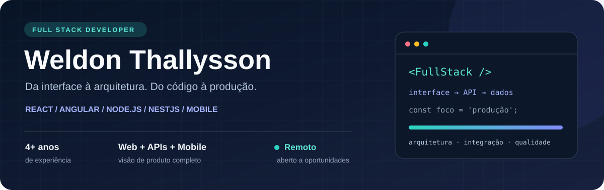

**WEB · BACK-END · MOBILE · PRODUTOS EM PRODUÇÃO**

[Projetos em produção](#-experiência-em-produção) · [Tecnologias](#-minha-stack) · [Explore meu código](#-explore-meu-código)

## Olá, sou o Weldon 👋

**Desenvolvedor Full Stack Pleno com mais de 4 anos de experiência.** Construo e evoluo aplicações web, APIs e produtos mobile nos setores de esporte, saúde, turismo e economia circular. Minha experiência conecta interfaces, regras de negócio, integrações e sustentação em produção.

<table><tr>
<td width="33%" valign="top"><h3>01 / INTERFACES</h3>React e Angular, componentes reutilizáveis, formulários e evolução de interfaces.</td>
<td width="33%" valign="top"><h3>02 / ARQUITETURA</h3>Node.js e NestJS, APIs REST, DDD, arquitetura hexagonal e integrações.</td>
<td width="33%" valign="top"><h3>03 / MOBILE</h3>React Native CLI e Ionic, autenticação, dados e experiências conectadas.</td>
</tr></table>

## 🚀 Experiência em produção

<table>
<tr>
<td width="50%" valign="top"><h3>⚽ Plataformas de sócio-torcedor</h3><b>FENG Brasil · Full Stack</b>
Flamengo, Maracanã Club, São Paulo, Barcelona Guayaquil, Botafogo, Fluminense e Vasco. E-commerce, checkout, PIX e integrações A&G e Reshop em aplicações de alto tráfego.

<b>Angular · TypeScript · Node.js · NestJS · PostgreSQL</b>
Responsável pelo front-end da nova plataforma <b>Nense / Fluminense</b>. Atuação temporária como Tech Lead, com code review e mentoria.</td>
<td width="50%" valign="top"><h3>♻️ Circulare</h3><b>Circular Brain · Back-end</b>
Gestão de resíduos e logística reversa. Evolução de MVC com Express para NestJS com arquitetura hexagonal e DDD.

<b>Node.js · NestJS · PostgreSQL · MongoDB</b>
Chatbot com <b>Botpress + Meta WhatsApp Business API</b> para solicitações de coleta e automações internas.</td>
</tr>
<tr>
<td width="50%" valign="top"><h3>🏥 Solus Saúde & H2J ERP</h3><b>TMR Consultoria · Front-end</b>
Interfaces responsivas, componentes reutilizáveis e refatoração de sistemas de saúde, ERP e CRM.

<b>React · TypeScript · Redux · Zustand · React Query · Zod</b>
<a href="https://novo.solus.inf.br/">Solus Saúde ↗</a> · <a href="https://h2j.com.br/">H2J ↗</a></td>
<td width="50%" valign="top"><h3>🏞️ Resort dos Canyons</h3><b>Plataforma de gestão turística</b>
Do desenvolvimento ao deploy: CMS, ERP, PDV, reservas, vendas e pagamentos com PagBank e Sicredi.

<b>React · Zustand · Express · PostgreSQL</b>
<a href="https://resortdoscanyons.com.br/">Conhecer o projeto ↗</a></td>
</tr>
<tr>
<td width="50%" valign="top"><h3>📱 K2B & FAP Clínicas</h3><b>Kompa Saúde · Mobile e Web</b>
Agendamento, geolocalização, autenticação, acesso por perfil e chatbots com WebSockets. Atuação em deploy e ambientes produtivos.
<b>React · Ionic · TypeScript · WebSockets</b></td>
<td width="50%" valign="top"><h3>🛒 K-Vendas & Cuiabautos Pneus</h3><b>Kasterweb · Mobile</b>
Aplicativos para vendas, pedidos, CRM e e-commerce. Arquitetura mobile, APIs REST e evolução do estado com Redux.

<b>React Native · Redux · APIs REST</b>
<a href="https://play.google.com/store/apps/details?id=com.kvendas2&hl=pt_BR">K-Vendas no Google Play ↗</a></td>
</tr>
</table>

<table><tr><td width="50%" align="center"><h3>40% → 90%</h3>Indicador de entrega e qualidade do time Contribuição durante minha atuação na FENG</td><td width="50%" align="center"><h3>R$ 24 mil+</h3>Vendas na inauguração Plataforma Resort dos Canyons</td></tr></table>

**Outros trabalhos do portfólio:** [CourtX](https://courtx.com.br/) · [RN Terraplanagem](https://rnterraplanagem.com.br/) · [UpStudio](https://upstudiodigital.com.br/)

## 🧩 Minha stack

| Área | Tecnologias e práticas |
| :--- | :--- |
| **Front-end** | React, Angular, Next.js, Redux, Context API, Zustand, React Query, React Hook Form, Zod, HTML e CSS |
| **Back-end** | Node.js, NestJS, Express, AdonisJS, APIs REST, PostgreSQL, MongoDB, MySQL, DDD e arquitetura hexagonal |
| **Mobile** | React Native CLI, Ionic, autenticação e integração com APIs |
| **Integrações** | Botpress, Meta WhatsApp Business API, WebSockets, checkout e PIX |
| **Qualidade e entrega** | Code review, Jest, Testing Library, Jasmine, TDD, Docker, CI/CD, AWS S3 e Lambda |

## 💻 Explore meu código

<table><tr>
<td width="50%" valign="top"><h3>01 · API de receitas</h3>
Autenticação JWT, usuários, categorias e receitas, com documentação Swagger e ambiente Docker.
<b>Node.js · TypeScript · Express · Prisma · MySQL · Jest</b>
<a href="https://github.com/WeldonThallysson/Backend_Receitas_Culinarias">Código e documentação ↗</a>
</td>
<td width="50%" valign="top"><h3>02 · Aplicativo de receitas</h3>
Aplicativo mobile com autenticação, gestão de receitas e perfil, integrado a APIs REST.
<b>React Native CLI · TypeScript · Zustand · Zod · Axios</b>
<a href="https://github.com/WeldonThallysson/Mobile_Receitas_Culinarias">Código e documentação ↗</a>
</td>
</tr><tr>
<td width="50%" valign="top"><h3>03 · AutoCar</h3>
Aplicação web com navegação, formulários e integração Firebase.
<b>React · TypeScript · Vite · Firebase · React Hook Form</b>
<a href="https://github.com/WeldonThallysson/Sistema_AutoCar">Explorar projeto ↗</a>
</td>
<td width="50%" valign="top"><h3>04 · Space Call</h3>
Sistema de chamados com autenticação e rotas protegidas.
<b>React · Firebase · React Router</b>
<a href="https://github.com/WeldonThallysson/Space_Call_Sistema_de_Chamados">Explorar projeto ↗</a>
</td>
</tr></table>

**05 · [Flynvi — sistema de viagens](https://github.com/WeldonThallysson/Flynvi-sistema-de-viagens):** demonstração com React, Redux, Redux Saga e API simulada.

[Ver todos os repositórios →](https://github.com/WeldonThallysson?tab=repositories)

## 🎓 Formação & certificações

**Engenharia de Software** · Descomplica Faculdade Digital · Em andamento  
**Meta Front-End Developer Professional Certificate** · Coursera / Meta  
React Native · TypeScript Avançado · Microcertificados em Engenharia de Software

---

<h3>Vamos construir o próximo produto?</h3>

Disponível para oportunidades <b>remotas</b> em Full Stack, Front-end, Back-end e Mobile.

<a href="https://www.linkedin.com/in/weldonthallysson/">LinkedIn</a> · <a href="mailto:weldon.dev.enginner@gmail.com">weldon.dev.enginner@gmail.com</a>

